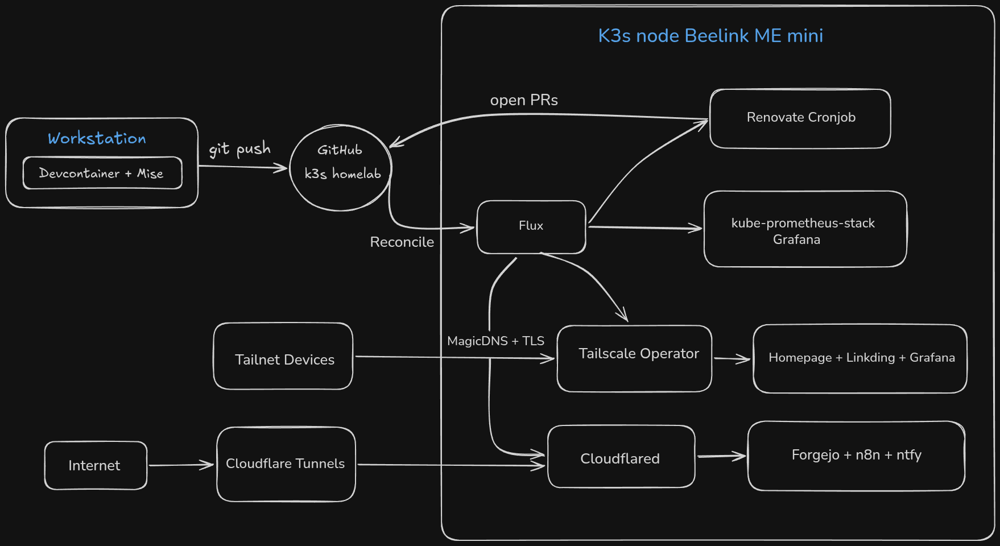
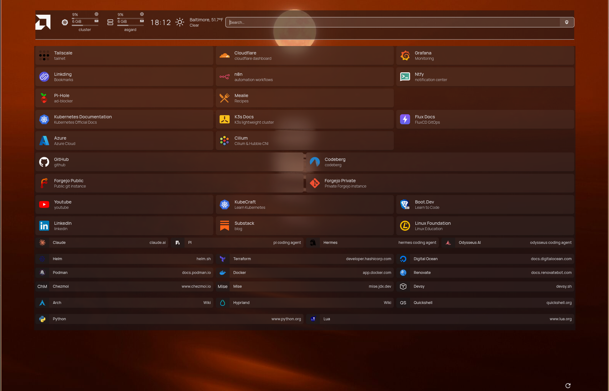

# Kubernetes Homelab

---

A self-hosted Kubernetes cluster managed entirely through GitOps. Every app, controller, and secret in the cluster is declared in this repo and reconciled by FluxCD. Nothing is applied by hand after a bootstrap.

The cluster runs on a single mini NAS today. The plan is to expand this to a 3 node cluster once my other hardware becomes available. (currently being used for kubeadm cluster in VMs studying for CKA)

## Highlights

- GitOps end-to-end. Flux watches `main` and reconciles infrastructure, monitoring, and apps in dependency order.
- Encrypted secrets in Git. Every credential is encrypted with SOPS + age and decrypted in cluster by Flux
- Private by default. Apps are reachable through the Tailscale Kubernetes Operator over my tailnet, with automatic TLS. Only apps that need to be public go out through Cloudflare tunnels. No ports are opened on the router.
- Automated dependency updates. Self-hosted Renovate CronJob scans images and Helm charts every four hours and opens PRs.
- Hardned workloads. Containers run as non-root with privilege escalation disabled. NetworkPolicies restrict Ingress
- Reproducible tooling. A devcontainer plus `mise` pins the full admin toolchain.
  - kubectl, helm, k9s, flux, Cilium, hubble, SOPS + age, cloudflared.

## Architecture

**Reconciliation order**
Flux applies repo as three kustomizations:

1) infrastructure controllers
2) monitoring controllers
3) apps

### Hardware

- Beelink ME mini 6-Slot Home Storage NAS PC Intel® N150

| Role | OS | CPU Cores/Threads | RAM | Storage |
| ------------- | -------------- | ----------------- | ------------ | ------- |
| Server + agent | Ubuntu Server | 4/4 | 12GB LPDDR5 | 4TB |

### Stack

| Layer | Tool | Notes |
| ---- | ---- | ---- |
| Disreibution | k3s | Lightweight Kubernetes |
| GitOps | FluxCD | Reconciles main every 10 minutes |
| CNI | Cilium + Hubble | eBPF networking and flow monitoring |
| Monitoring | kube-prometheus-stack | Prometheus, Alermanager, Grafana |
| Ingress (Private) | Tailscale Operator | MagicDNS hostnames, automatic TLS certs |
| Ingress (Public) | Cloudflare Tunnels | Outbound only, no open ports |
| Secrets | SOPS + age | Decrypted by Flux at deploy time |
| Updates | Renovate Bot | CronJob every 4 hours, PRs to GitHub |

### Applications

| Applications | Description | Access | Deployment | Status |
| ------- | --------- | ------ | ------ | ----- |
| Homepage | browser dashboard | Tailscale | Manifests | Active |
| Grafana | monitoring dashboard | Tailscale | Helm (kube-prometheus-stack) | Active |
| linkding | bookmark manager | Tailscale | Manifests | Active |
| Forgejo | self-hosted Git | Cloudflare tunnel | Helm | Active |
| n8n | workflow automation | Cloudflare tunnel | Manifests | Active |
| ntfy | notification center | Cloudflare tunnel | Manifests | Active |
| Mealie | recipe manager | Tailscale | Manifests | Paused |
| Audiobokshelf | audiobook library | Tailscale | Mainfests | Paused |

### Screenshots

### Design Decisions

- Tailscale for private access: Want to keep any applications that only need to be reached by me behind Tailscales extra encryption layer.
- Cloudflare for public access: Anything that needs outside to the internet go through Cloudflare tunnels. The tunnels are outbound only, so no open ports on my home network.
  - Forgejo for public readability
  - n8n for HTTP requests
  - ntfy for push notifications to my phone even when tailscale is disabled.
- Plain manifests over Helm charts: For single container applications, explicit manifests keep the security context, resources, and probes easier to review and maintain than large values files.
- Update policy for kube-prometheus-stack: Minor and patch updates happen automatically. Major versions done by hand, so any breaking changes can be reviewed before they are applied.
- Self-hosted Renovate: Using a CronJob in the cluster keeps the updating in the same GitOps loop that it manages.

### Admin Environment

Designed to run inside a devcontainer. Mise installs the toolchain, and mounts `~/.kube` inside the devcontainer
